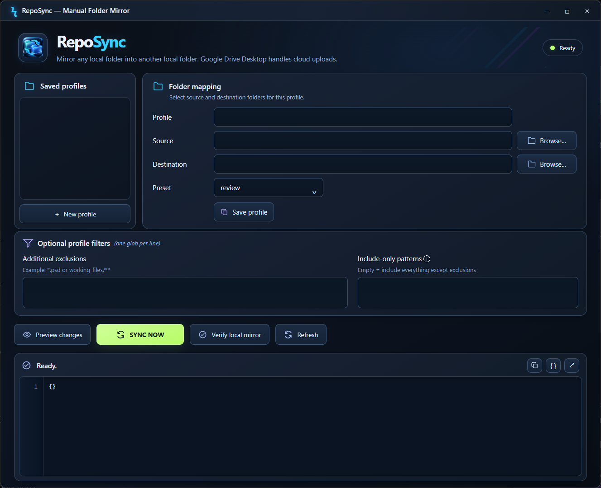

# RepoSync

**Friendly local folder mirroring for Windows, with a CLI for agents.**

RepoSync makes one folder an exact copy of another. It works with any local folder, with or without Git. Typical use: mirror a project into a folder watched by Google Drive Desktop, so Drive picks up a clean copy.

[**Download RepoSync v0.2.7 for Windows**](https://github.com/iona095/RepoSync/releases/download/v0.2.7/RepoSync_Setup_v0.2.7.exe) · [Release notes](https://github.com/iona095/RepoSync/releases/tag/v0.2.7) · [Website](https://apps.pixelcraftsco.com/reposync)

SHA-256 of `RepoSync_Setup_v0.2.7.exe`:
`2B50585B085457D9D604C6F0899BA8A2ADE532237841D2D7339754B444793A66`

The installer is not code-signed yet, so Windows SmartScreen may warn on first run. Check the hash above before installing.



## How it works

1. Pick a **source** folder and a **destination** folder and save them as a profile.
2. **Preview** to see exactly what would be copied, updated or deleted.
3. **Sync** manually when you are happy with the preview.
4. **Verify** the mirror with SHA-256 checks.

Good to know:
- Sync is **exact**: extra files in the destination are deleted so it matches the filtered source. **Source files are never deleted.** Try it on a disposable folder first.
- There is no scheduler, no automatic sync and no direct upload. If the destination is watched by Google Drive Desktop, that app handles the cloud side, and you should check its upload separately.
- Presets (`review`, `code`) and custom include/exclude globs control what gets mirrored.
- Profiles are saved in `%LOCALAPPDATA%\RepoSync\profiles.json` and survive updates and uninstalling.

## Requirements

- Windows with the Microsoft Edge WebView2 Runtime (the installer does not bundle it).
- Per-user install, no admin rights needed.

## Agent CLI

The installer includes `RepoSyncCLI.exe`. Read-only commands can return JSON:

```powershell
$cli = "$env:LOCALAPPDATA\RepoSync\bin\RepoSyncCLI.exe"
& $cli --version
& $cli list --json
& $cli preview MyProfile --json
& $cli verify MyProfile --json
# Sync deletes from the destination. A human should authorize it:
# & $cli sync MyProfile --yes --json
```

An optional agent skill is in [`source/skills/reposync`](source/skills/reposync/SKILL.md). Installing it does not give agents permission to run destructive operations.

## Docs

- [User manual](source/MANUAL.md)
- [CLI reference](source/skills/reposync/references/CLI_REFERENCE.md)
- [Windows acceptance checklist](WINDOWS_ACCEPTANCE_v0.2.7.md)

## Building from source

Requires Windows, PowerShell 7, Python 3.12 and Inno Setup. The build script installs pinned dependencies (pywebview, PyInstaller) and writes the installer to `release\`.

```powershell
pwsh -NoProfile -ExecutionPolicy Bypass -File .\Build-RepoSync-Installer.ps1
```

Tests are in [`tests/`](tests/) and [`scripts/`](scripts/).

## License

MIT. See [LICENSE](LICENSE). Third-party components keep their own licenses (pywebview BSD-3-Clause, pythonnet MIT, PyInstaller with its bootloader exception).

Made by [PixelCrafts Co](https://pixelcraftsco.com/).
